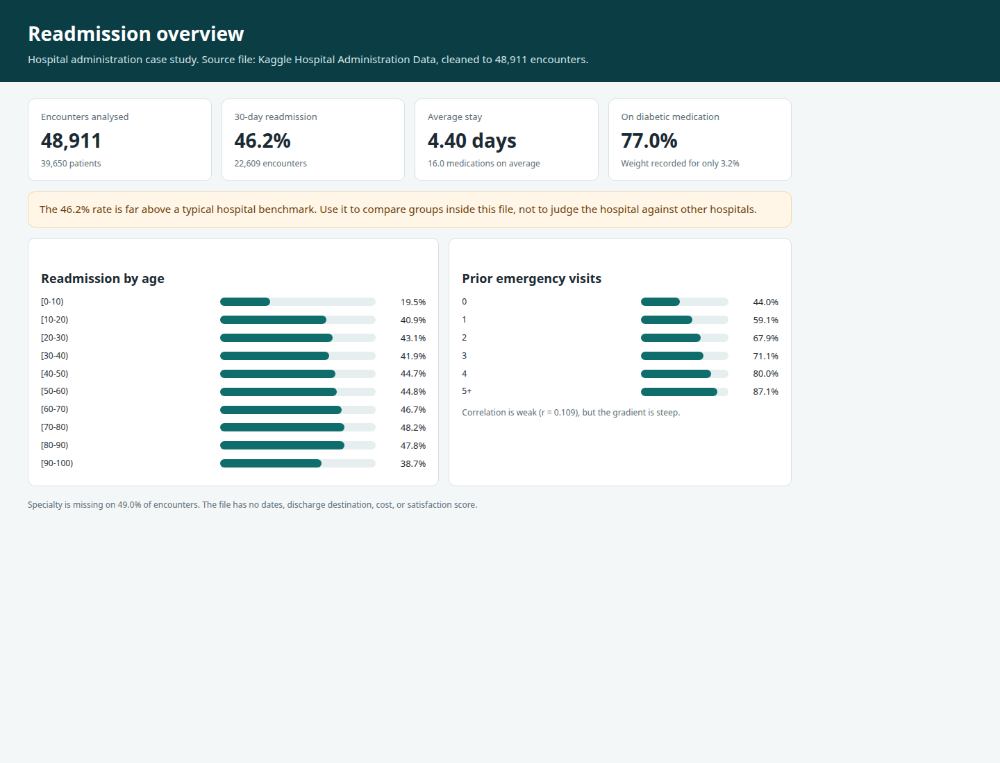

# Hospital readmission analysis

A hospital administration case study on what is associated with readmission within 30 days, and where follow-up should go first.

## Overview

The hospital has a high readmission rate and needs a practical reading of its encounter file: who comes back, which services keep patients longer, and which signals are strong enough to change discharge practice. This repository cleans that file, answers the case-study questions, and writes a workbook plus a short dashboard.

The only dataset is the Kaggle extract [Hospital Administration Data](https://www.kaggle.com/datasets/shivavashishtha/hospital-administration-data/) (`HA Data.csv`). No other clinical database is used.

## Objectives

- Measure 30-day readmission by age, specialty, prior visits, diabetes treatment, medications, and diagnosis group.
- State clearly which questions the file cannot answer, instead of inventing dates, cost, satisfaction, or discharge destination.
- Rank encounters with the logistic model specified in the solution guide, and keep race and gender out of the score.
- Show the cost and follow-up programme as scenarios with editable assumptions.

## Tools

- Python 3, pandas, NumPy, SciPy, statsmodels, and scikit-learn
- xlsxwriter for the Excel workbook
- pytest for the reconciliation checks
- The dashboard is static HTML generated from the same results

## Repository layout

| Path | What it is |
| --- | --- |
| `data/Hospital_Administration_Database.csv` | Dataset used. The Kaggle archive file `HA Data.csv`, saved under this name. |
| `hospital_readmission/` | Working project code: cleaning, statistics, model, workbook, report, and dashboard. |
| `outputs/Hospital_Readmission_Analysis.xlsx` | Workbook. Rate tables are formulas on `Clean_Data`. Yellow cells are assumptions. |
| `outputs/RESULTS.md` | Findings, limits, and the action for each question. |
| `dashboard/` | Dashboard pages. |
| `dashboard/screenshots/` | Screenshots of those pages. |
| `tests/test_core.py` | Checks on cleaning, the published age counts, and the cost identity. |
| `requirements.txt` | Python packages. |

## Process

1. Read the Kaggle CSV as text so `None` in `X1` and `X2` stays the text "test not performed".
2. Drop the source `index` column and 17,676 exact duplicate rows. 48,911 encounters remain, from 39,650 patients.
3. Drop `diag_4` (an exact copy of `diag_3`) and `diag_5` (decimals, not diagnosis codes).
4. Recode `?` in race, weight, and specialty.
5. Map `X3` to `X25` with the medication names in the solution-guide appendix. Confirm those names before clinical use.
6. Keep `readmitted` as provided: 1 means readmitted within 30 days.
7. Answer the descriptive questions with rates, chi-square, two-proportion z-tests, correlation, regression, and ANOVA.
8. Fit an unpenalized logistic regression on the 13 admission-time variables in the guide. Hold out 30% of patients (`random_state` 0). Tier labels use 5-fold out-of-fold scores. Gradient boosting is only the benchmark.
9. Leave seasonality, discharge disposition, mortality, satisfaction, and dollars as gaps or labelled scenarios.

## How to run

```bash
python -m pip install -r requirements.txt
python -m hospital_readmission
pytest
```

`python -m hospital_readmission` reuses `data/Hospital_Administration_Database.csv` when it is present. It rewrites the workbook, `outputs/RESULTS.md`, and `dashboard/overview.html` and `dashboard/risk.html`. Open those HTML files in a browser. The screenshots already in `dashboard/screenshots/` were taken from those pages.

The run stops if the cleaned file is not 48,911 encounters, 22,609 readmissions, and 39,650 patients, or if a patient appears in both the training and test sets.

## Key insights

- **46.2%** of the 48,911 encounters are coded as readmitted within 30 days (22,609). That is much higher than a typical hospital rate, so compare groups inside this file rather than benchmarking the hospital.
- Readmission peaks at **48.2%** in ages **[70-80)** (12,478 encounters; chi-square 113.39).
- Prior emergency visits have a weak correlation (**r = 0.109**) and a steep gradient, from about 44% with no prior emergency visit to about 87% with 5 or more.
- Patients on diabetic medication are readmitted at **47.9%**, versus **40.5%** for others. A medication change is **4.6 percentage points** higher (z = 10.11). That is an association, not proof that the change caused the readmission.
- More medications go with longer stays (**r = 0.465**, about **0.17** extra days per medication). The longest recorded stays are in rehabilitation, psychiatry, and psychology. Specialty is missing on **49.0%** of encounters, and weight on **96.8%**.
- The logistic model AUC is **0.652** on the patient holdout. The gradient-boosting benchmark is **0.667**. The high-risk third is readmitted at about **62%**, well above the low-risk third. Race and gender are not inputs to the score.
- There is no admission date, discharge disposition, cost, satisfaction score, or death field. Those questions are not filled in.

## Dashboard




## Limits

Weight and specialty are poorly captured. Patients can appear more than once, so ordinary standard errors are slightly too small. The risk score supports follow-up intensity. It is not a reason to deny care.
# hospital-readmission
